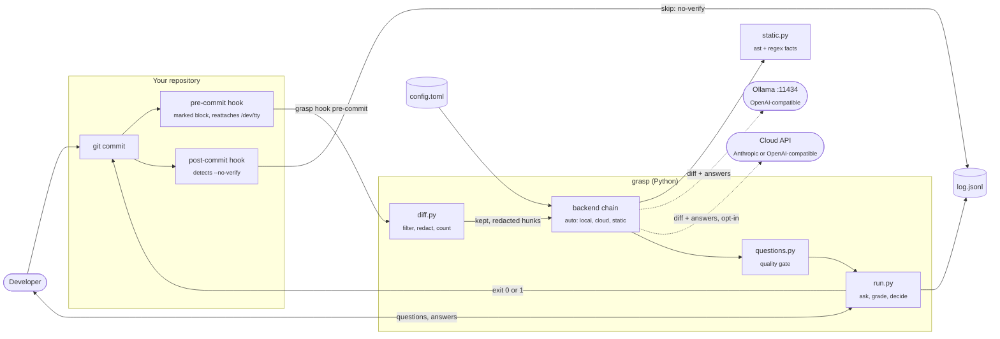
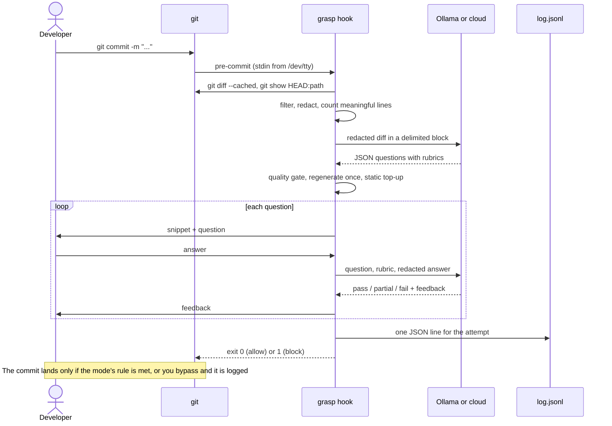

<a id="readme-top"></a>

<!-- PROJECT SHIELDS -->
<div align="center">

[![Contributors][contributors-shield]][contributors-url]
[![Forks][forks-shield]][forks-url]
[![Stargazers][stars-shield]][stars-url]
[![Issues][issues-shield]][issues-url]
[![MIT License][license-shield]][license-url]

</div>

<!-- PROJECT LOGO -->
<br />
<div align="center">
  <h3 align="center">grasp</h3>
  <p align="center">
    A git pre-commit hook that asks you to explain your staged diff before it lands
    <br />
    <a href="https://github.com/teddycitrus/grasp"><strong>Explore the docs &raquo;</strong></a>
    <br />
    <br />
    <a href="https://github.com/teddycitrus/grasp/issues/new?labels=bug">Report Bug</a>
    &middot;
    <a href="https://github.com/teddycitrus/grasp/issues/new?labels=enhancement">Request Feature</a>
  </p>
</div>

<!-- TABLE OF CONTENTS -->
<details>
  <summary>Table of Contents</summary>
  <ol>
    <li>
      <a href="#about-the-project">About The Project</a>
      <ul>
        <li><a href="#what-a-question-looks-like">What A Question Looks Like</a></li>
        <li><a href="#backends">Backends</a></li>
        <li><a href="#built-with">Built With</a></li>
      </ul>
    </li>
    <li><a href="#architecture">Architecture</a></li>
    <li>
      <a href="#getting-started">Getting Started</a>
      <ul>
        <li><a href="#prerequisites">Prerequisites</a></li>
        <li><a href="#set-up-in-60-seconds">Set Up In 60 Seconds</a></li>
        <li><a href="#local-model-optional">Local Model (Optional)</a></li>
        <li><a href="#cloud-model-optional">Cloud Model (Optional)</a></li>
      </ul>
    </li>
    <li><a href="#usage">Usage</a></li>
    <li><a href="#configuration">Configuration</a></li>
    <li><a href="#privacy">Privacy</a></li>
    <li><a href="#roadmap">Roadmap</a></li>
    <li><a href="#contributing">Contributing</a></li>
    <li><a href="#license">License</a></li>
    <li><a href="#contact">Contact</a></li>
  </ol>
</details>

<!-- ABOUT THE PROJECT -->
## About The Project

AI coding tools make it easy to commit code you cannot explain. grasp is a pre-commit hook that asks you two or three short questions about your staged diff and holds the commit until you answer them well enough. Each question names a real function, condition or call from your change and shows you the code next to it. Someone who wrote and understood the change can answer in a sentence or two. Someone who pasted it without reading it usually cannot.

It works fully offline. The default static backend needs no model and no network. A local model through Ollama or a cloud API gives better questions and real grading if you want them.

What grasp does on each commit:

* Reads `git diff --cached` and drops noise: lockfiles, binaries, minified and generated files, vendored directories, secret-looking files (`.env`, `*.pem`, ...) and anything in `.graspignore`.
* Redacts secret-like strings (API keys, tokens, passwords, private keys, credentials in URLs) before anything can leave the machine.
* Counts meaningful changed lines, ignoring blank, comment-only, import-only and whitespace-only changes. Under the threshold (default 15) it does nothing.
* Asks 2 questions for up to 60 meaningful lines and 3 above that, one at a time. Answers are free text; finish with an empty line, or type `idk`.
* Grades each answer, shows what a good answer covers, then allows or blocks the commit.

<p align="right">(<a href="#readme-top">back to top</a>)</p>

### What A Question Looks Like

```
grasp: 20 meaningful lines changed. 2 questions, backend: static (honor system), mode: strict.

Question 2 of 2  [orders.py]
   13 +     if coupon is not None:
   14 +         if coupon.expired:
   15 +             raise ValueError("coupon expired")
   ...

In `total`, the new check `coupon.expired` makes it raise `ValueError` early. What situation is
this guarding against, and what would go wrong further down without it?
Answer (finish with an empty line; type "idk" if unsure):
>
```

Every question passes a programmatic gate before you see it: it must name an identifier that appears in the diff, must not match a list of generic phrases ("what does this change do", "why did you make this change", Big-O, other files, line numbers), must not just ask what something is or does, must not contain its own answer, and must carry a rubric of 1 to 3 points. Questions from a model that fail the gate are regenerated once, and any still missing are filled from the static backend.

### Backends

`backend = "auto"` tries local, then cloud (only if you enabled it), then static. Any failure (server down, timeout, bad JSON) falls through to the next one. If everything fails, grasp allows the commit and logs the error.

| | static | local | cloud |
|---|---|---|---|
| Setup | none | install Ollama, `ollama pull qwen2.5-coder:7b` | API key in an env var, opt in during `grasp init` |
| Privacy | nothing leaves the machine | nothing leaves the machine (talks to `localhost:11434`) | filtered, redacted diff and your answers go to the provider |
| Question source | templates filled from facts in the diff (Python `ast`, regex for other languages) | model, then the quality gate, then static top-up | model, then the quality gate, then static top-up |
| Grading | honor system: a minimal automatic check, then you compare your answer to a checklist and grade yourself | model compares your answer to the rubric | model compares your answer to the rubric |
| Grading quality | weakest; it trusts you | fair; small models get a rubric so they only compare | best of the three |
| Latency (measured) | under 0.1 s | qwen2.5-coder 7B on an 8-core CPU with no GPU: 20 to 70 s to generate, about 18 s per graded answer (a GPU should be much faster; not measured) | gpt-4o-mini: 2 to 5 s to generate, about 1.5 s per graded answer |

The static backend looks for: new or changed conditions, removed branches, removed calls, new parameters, changed defaults, new raises and exception handlers, early returns, changed constants and new loops. If it finds nothing concrete (for example, a prose-only change), the commit is allowed and logged.

<p align="right">(<a href="#readme-top">back to top</a>)</p>

### Built With

| layer | tools |
|---|---|
| language |  |
| http |  |
| local models |  |
| tests |  |

The only runtime dependency is httpx. The CLI uses argparse.

<p align="right">(<a href="#readme-top">back to top</a>)</p>

<!-- ARCHITECTURE -->
## Architecture



Every pre-commit run applies these rules in order:

1. `GRASP_SKIP=1` allows the commit and logs a skip.
2. A rebase, merge, cherry-pick or revert in progress allows the commit silently.
3. Noise files are dropped and secrets redacted. Fewer meaningful lines than the threshold allows the commit silently.
4. No terminal (IDE commit, `CI` set) allows the commit and logs a skip.
5. Questions are generated through the backend chain, asked one at a time, and graded.
6. The mode decides: `strict` needs every answer to pass, `normal` needs more than half to pass or be partial, `advisory` never blocks.
7. On a block you choose: retry with fresh questions, bypass once (logged as a skip), or abort.



Limits and guarantees:

* Fails open. Any internal error, or every backend failing, allows the commit and writes the error to the log.
* Never more than 3 questions per attempt.
* Diff budget sent to a model: about 3000 tokens for local and 12000 for cloud (estimated at 4 characters per token, largest files first).
* Timeouts: 2 s health check for Ollama, 120 s per local request, 30 s per cloud request. Malformed JSON gets one retry; rejected questions get one regeneration.
* The diff and your answers are wrapped in delimited blocks, closing tags inside them are neutralised, and the model is told to ignore instructions in them. Replies must be JSON and are validated before use.
* Cloud is never used unless you opt in during `grasp init`, even with `backend = "auto"` and a key in your environment.

<p align="right">(<a href="#readme-top">back to top</a>)</p>

<!-- GETTING STARTED -->
## Getting Started

### Prerequisites

* Python 3.11 or newer
* git
* [pipx](https://pipx.pypa.io/) or [uv](https://docs.astral.sh/uv/)

### Set Up In 60 Seconds

1. Install grasp from a clone (the package name on PyPI will be `git-grasp`; it is not published yet)
   ```sh
   git clone https://github.com/teddycitrus/grasp.git
   cd grasp
   pipx install .
   ```
   or, with uv:
   ```sh
   uv tool install .
   ```
2. Turn it on in a repository. `grasp init` checks for Ollama and API keys, asks for backend, mode and threshold, then installs the hooks. It never overwrites an existing hook: it appends a marked block, or stops and tells you the one line to add.
   ```sh
   cd path/to/your/repo
   grasp init
   ```
   To accept the defaults without prompts (auto backend, normal mode, threshold 15, cloud off):
   ```sh
   grasp init --yes
   ```
3. Commit as usual. grasp asks its questions when the change is big enough.

### Local Model (Optional)

grasp never downloads models. Install [Ollama](https://ollama.com/download), then pull the recommended model:

```sh
ollama pull qwen2.5-coder:7b
```

On machines with less RAM, use the 3B model and set `model = "qwen2.5-coder:3b"` under `[local]` in the config:

```sh
ollama pull qwen2.5-coder:3b
```

### Cloud Model (Optional)

Export a key, then run `grasp init` and accept the privacy notice. grasp sends one tiny request to check the key.

```sh
export ANTHROPIC_API_KEY=your-key
grasp init
```

`OPENAI_API_KEY` works the same way. Any other OpenAI-compatible endpoint works by editing `base_url`, `model` and `api_key_env` under `[cloud]`.

<p align="right">(<a href="#readme-top">back to top</a>)</p>

<!-- USAGE -->
## Usage

| Command | What it does |
|---|---|
| `grasp init` | Interactive setup, then installs the pre-commit and post-commit hooks in the current repo |
| `grasp init --yes` | Same with defaults, no prompts; never enables cloud |
| `git commit` | Runs grasp through the hook when the change has enough meaningful lines |
| `GRASP_SKIP=1 git commit -m "msg"` | Skips grasp once; logged as a skip |
| `git commit --no-verify -m "msg"` | Skips all pre-commit hooks; the post-commit hook logs it as a skip |
| `grasp log` | Last 10 attempts, weak spots by question type, and skip counts |
| `grasp log -n 50` | Last 50 attempts |
| `grasp eval` | Runs the static generator on the bundled fixture diffs and prints every question with its automatic checks |
| `grasp eval --backend local --snippets` | Same with your local model, including the code shown with each question; prints latency per case |
| `grasp uninstall` | Removes grasp's blocks from this repo's hooks and leaves everything else in place |

Example `grasp log` output:

```
2026-10-30 02:51  repo             blocked       static         fail fail
2026-10-30 02:51  repo             pass          static         pass pass
2026-10-30 02:51  repo             skip          -              GRASP_SKIP=1
2026-10-30 02:51  repo             skip          -              no-verify

Last 4 attempts:
  Weak spots: removed code (2 of 2 not fully passed), branches and edge cases (2 of 4 not fully passed)
  Skips: 2 (GRASP_SKIP=1: 1, no-verify: 1)
```

To work on grasp itself:

```sh
pip install -e ".[dev]"
pytest
```

<p align="right">(<a href="#readme-top">back to top</a>)</p>

<!-- CONFIGURATION -->
## Configuration

`grasp init` writes `~/.config/grasp/config.toml` (or `$XDG_CONFIG_HOME/grasp/config.toml`). The API key is never stored there, only the name of the env var that holds it.

```toml
backend = "auto"        # auto | static | local | cloud
mode = "normal"         # strict | normal | advisory
threshold = 15          # minimum meaningful changed lines before asking

[local]
base_url = "http://localhost:11434/v1"
model = "qwen2.5-coder:7b"
max_diff_tokens = 3000
timeout = 120

[cloud]
provider = "anthropic"  # anthropic | openai (any OpenAI-compatible endpoint)
base_url = "https://api.anthropic.com"
model = "claude-haiku-4-5"
api_key_env = ""        # empty means cloud is off
max_diff_tokens = 12000
timeout = 30
```

A `.graspignore` file in the repo root takes one pattern per line: `docs/` matches a directory, `*.sql` or `scripts/gen_*.py` match files. Lines starting with `#` are comments.

<p align="right">(<a href="#readme-top">back to top</a>)</p>

<!-- PRIVACY -->
## Privacy

* **static and local:** nothing leaves your machine. The local backend only talks to the Ollama URL in your config, which is `localhost` by default.
* **cloud:** the filtered, redacted staged diff, the question, its rubric and your redacted answer are sent to the provider you chose. Nothing else is sent: no file list outside the diff, no repo name, no log contents.
* Redaction is pattern-based. It catches common key formats (AWS, OpenAI-style `sk-`, GitHub, Slack, Google, JWTs), private key blocks, credentials in URLs, `password`/`token`/`secret` assignments and high-entropy quoted strings. It cannot catch every secret. Use `.graspignore` for files that must never be read.
* The log at `~/.local/share/grasp/log.jsonl` (or `$XDG_DATA_HOME/grasp/log.jsonl`) stays on your machine. It holds timestamps, repo paths, file names, questions, your redacted answers and grades.
* Bypasses are possible by design (`--no-verify`, `GRASP_SKIP=1`, uninstalling the hook). grasp is a habit tool for people who want it, not an enforcement mechanism.

<p align="right">(<a href="#readme-top">back to top</a>)</p>

<!-- ROADMAP -->
## Roadmap

- [x] Static, local and cloud backends with fall-through and fail-open behavior
- [x] Programmatic question quality gate and `grasp eval` for tuning prompts
- [ ] Tree-sitter extractors for languages other than Python, behind the existing extractor interface
- [ ] Publish `git-grasp` to PyPI

See the [open issues](https://github.com/teddycitrus/grasp/issues) for a full list of proposed features and known issues.

<p align="right">(<a href="#readme-top">back to top</a>)</p>

<!-- CONTRIBUTING -->
## Contributing

Contributions are welcome. If you have a suggestion, fork the repo and open a pull request, or open an issue with the tag "enhancement". New fixture diffs under `src/grasp/eval_fixtures/` that produce weak questions are especially useful.

1. Fork the Project
2. Create your Feature Branch (`git checkout -b feature/AmazingFeature`)
3. Commit your Changes (`git commit -m 'Add some AmazingFeature'`)
4. Push to the Branch (`git push origin feature/AmazingFeature`)
5. Open a Pull Request

<p align="right">(<a href="#readme-top">back to top</a>)</p>

<!-- LICENSE -->
## License

Distributed under the MIT License. See `LICENSE` for more information.

<p align="right">(<a href="#readme-top">back to top</a>)</p>

<!-- CONTACT -->
## Contact

Project Link: [https://github.com/teddycitrus/grasp](https://github.com/teddycitrus/grasp)

<p align="right">(<a href="#readme-top">back to top</a>)</p>

<!-- MARKDOWN LINKS & BADGES -->
[contributors-shield]: https://img.shields.io/github/contributors/teddycitrus/grasp.svg?style=for-the-badge&cacheSeconds=60
[contributors-url]: https://github.com/teddycitrus/grasp/graphs/contributors
[forks-shield]: https://img.shields.io/github/forks/teddycitrus/grasp.svg?style=for-the-badge&cacheSeconds=60
[forks-url]: https://github.com/teddycitrus/grasp/network/members
[stars-shield]: https://img.shields.io/github/stars/teddycitrus/grasp.svg?style=for-the-badge&cacheSeconds=60
[stars-url]: https://github.com/teddycitrus/grasp/stargazers
[issues-shield]: https://img.shields.io/github/issues/teddycitrus/grasp.svg?style=for-the-badge&cacheSeconds=60
[issues-url]: https://github.com/teddycitrus/grasp/issues
[license-shield]: https://img.shields.io/badge/license-MIT-blue.svg?style=for-the-badge
[license-url]: https://github.com/teddycitrus/grasp/blob/main/LICENSE
